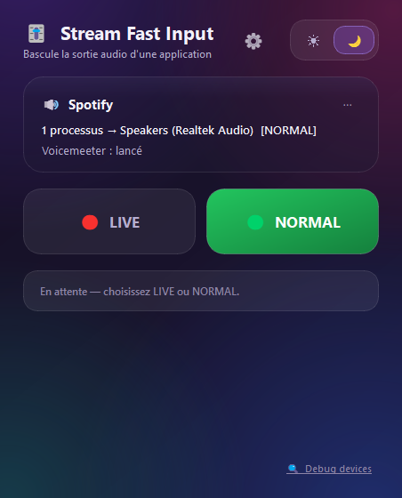
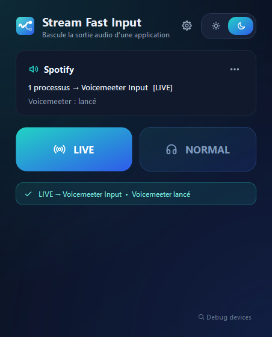
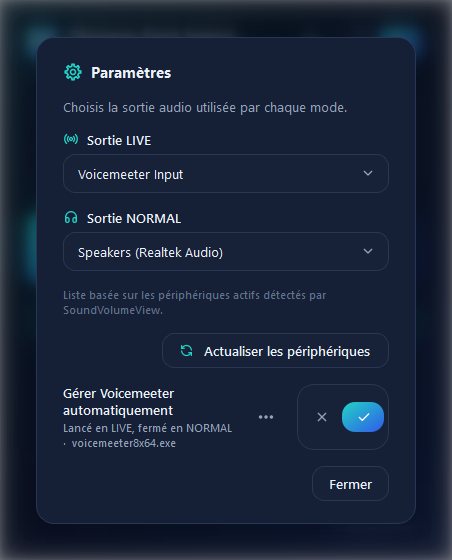
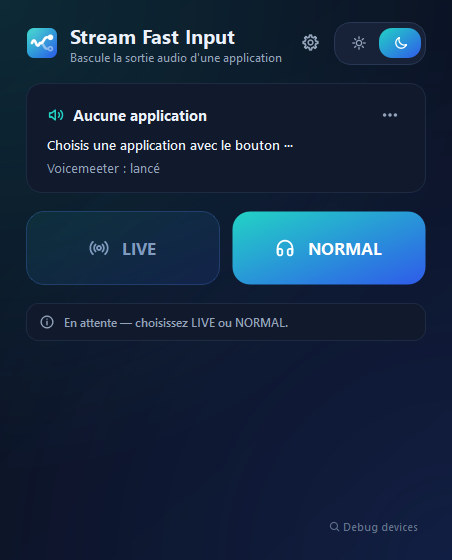
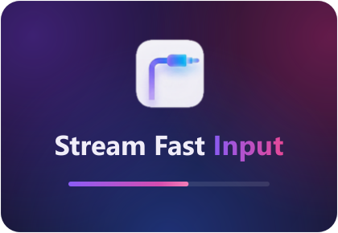

<div align="center">


# Stream Fast Input

Instantly reroute any app's audio output to a different device — no more digging through Windows sound settings mid-stream.

[**⬇ Download for Windows**](https://github.com/StundZow/stream-fast-input/releases/latest/download/StreamFastInput.exe) · [Releases](https://github.com/StundZow/stream-fast-input/releases)



</div>

## What it does

Stream Fast Input is a tiny always-on-top utility for **one specific problem**: you're streaming or recording, and you need Spotify (or Discord, a game, anything) to suddenly output to a different audio device — your mix, your recording input, whatever — and then flip it back when you're done. Doing that by hand through Windows' sound settings every time gets old fast.

Two big buttons. **LIVE** routes your chosen app to one device. **NORMAL** routes it back to another. That's the whole interaction.

It can optionally start/stop [Voicemeeter](https://vb-audio.com/Voicemeeter/) alongside the switch, since that's a common pairing for this workflow.

## Why not just use Windows' per-app volume mixer?

Windows lets you pick a default output device per-app since Windows 11, but it's buried a few clicks deep and doesn't remember two states you can toggle between. This is that toggle, one click away, always on top.

## Features

- 🎯 **Works with any app** — pick the `.exe` once, it's remembered
- 🔊 **Two configurable outputs** — LIVE and NORMAL each route to whichever device you pick from a live-scanned list
- 🎚️ **Optional Voicemeeter automation** — launches it when going LIVE, closes it going NORMAL (toggle-able, and you can point it at a non-default install path)
- 🌗 **Dark / light theme**, follows Windows by default
- 📌 **Always-on-top** compact window, stays out of the way
- 🪶 **Single portable `.exe`**, nothing to install

<div align="center">

&nbsp;&nbsp;

</div>

## Getting started

1. [Download `StreamFastInput.exe`](https://github.com/StundZow/stream-fast-input/releases/latest/download/StreamFastInput.exe) and run it — no installer, no admin rights needed.
2. The app ships **completely blank** — nothing is preconfigured, since every setup is different. On first launch:
   - Click **⋯** next to "Aucune application" and pick the `.exe` whose audio you want to control (e.g. `Spotify.exe`).
   - Open **Settings** (⚙) and pick the output device for **LIVE** and for **NORMAL** from the dropdown — the list is scanned live from your actual devices.
   - If you use Voicemeeter and it's not installed at the default path, use the **⋯** next to "Gérer Voicemeeter automatiquement" to point at your `voicemeeterXXXX.exe`.
3. Click **LIVE** or **NORMAL** whenever you need to switch. Settings are remembered for next time.

<div align="center">

</div>

## How it works

Under the hood it drives [NirSoft's SoundVolumeView](https://www.nirsoft.net/utils/sound_volume_view.html) (bundled, no separate download) to set the per-app default output device — the same mechanism Windows' own per-app volume mixer uses, just scriptable and one click away.

## Launch screen

<div align="center">

</div>

From the double-click, a launch screen shows up right away — icon, app name, a progress bar with a sweeping highlight, colour halos drifting like the app's own background — then fades into the main window once it's ready. The bar only moves on **real** steps of the startup (font database loaded, emoji font loaded, UI built, window shown), never on a timer, so it never pretends progress that hasn't happened.

Why a launch screen at all: the first text a Qt app draws on Windows costs about **1.5 s** — the font database (several hundred installed families), then the emoji font the interface uses. It's paid once per process, but it freezes that process while it happens, so no animation can run *inside* the app during its own startup. The launch screen therefore runs in a **second, lightweight process** (the same exe relaunched with `--splash`) that draws only images and shapes — no text, or it would pay the font database too; the app name is a pre-rendered image (see `tools/make_wordmark.py`). Measured on the release build, it's on screen about **0.85 s** after the double-click, where the main window only arrives at ~2.5 s. It closes itself if the app disappears, and never outlives 20 s regardless.

## Requirements

- Windows 10/11
- [Voicemeeter](https://vb-audio.com/Voicemeeter/) only if you want the automatic launch/close feature — entirely optional otherwise

## Building from source

```bash
pip install -r requirements.txt
python main.py                       # run from source
pyinstaller StreamFastInput.spec     # build the standalone .exe
python tools/make_wordmark.py        # regenerate the launch-screen wordmark after a rename / font / palette change
```

Set `SFI_TIMING=<path to a log file>` before launching to get a timestamped breakdown of every startup step, measured from the double-click.

## License

[MIT](LICENSE)
